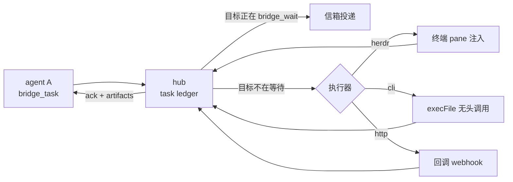

# agent-comm-hub A2A 能力审查与改进方案

审查对象：`agent-comm-hub` 0.9.1（`src/`）+ 桌面端 `agent-comm-hub-app` 1.5.0（`app/`）。
本文只描述现状与方案，不含任何已实施的改动。

## 0. 审查方法与证据等级

读了 `src/` 全部 12 个模块、`app/src-tauri/src/` 全部 7 个模块与前端 stores/views、`agents/SKILL.md`、
`agents/registry.json`、`agents/install-all.ps1`、`README*.md`、`ARCHITECTURE.md`、`docs/agent-discovery.md`、
`docs/agent-registry.schema.json`、`app/docs/*`、`test/`。

执行的验证（复现脚本在 `.tmp/`，未纳入版本控制）：

- `pnpm test` — 291 项全绿（165 smoke + 37 setup + 11 ops + 35 herdr + 23 discover + 20 e2e），exit 0。
- `.tmp/verify-gc-mailbox.mjs` — 复现空闲回收连带丢弃离线信箱（L1）。
- `.tmp/verify-session-drift.mjs` — 复现 hub 重启后会话身份静默退化（L1）。
- `.tmp/verify-setup-creates.mjs` — 复现 `setup` 在空 home 上凭空创建技能目录、
  以及“配置文件存在即视为已安装”（L1）。
- 对当前机器的实测：`~/.config/opencode/opencode.json` 等 6 个配置文件存在，
  但 `gemini` / `codex` / `claude` 三个探测命令不在 PATH 上，而 `~/.minimax/` 不存在——
  正好对应下面 R11 的两类问题（L1）。
- `.tmp/verify-origin.mjs` / `.tmp/verify-origin-remote.mjs` — 复现本地模式下任意网页可跨域
  走通 MCP 握手并抢注 `agent-hub-cli`；远程模式无 token 则 401（L1）。
- `.tmp/verify-example-tokens.mjs` — 复现随包的示例令牌表能通过校验并含一枚 manager 令牌（L1）。

证据等级按个人规则：**L1** 执行/复现所得，**L2** 代码与调用链可核对，**L3** 推断。

## 1. 结论

这套东西的传输、身份、路由、持久化和测试都做得扎实，问题不在工程质量，而在**语义层级**：
它现在实现的是**信箱（mailbox）语义**，不是**对等协作（A2A）语义**。
「把消息送到对方信箱」这件事它做得很好；「让对方真的干活、并把结果可靠地带回来」这件事，中间那一段基本是空的。

具体差在五处：

| # | 缺口 | 一句话 |
|---|---|---|
| 1 | **可达性** | 对方不在线就完全不可达；而且「离线信箱」会在空闲回收时被一起删掉（L1 复现） |
| 2 | **投递语义** | 消息取出即删，没有确认、没有游标；响应在网络上丢失就等于消息永久丢失 |
| 3 | **唤醒** | 协议实际是拉取式的，SSE 推送对第三方 agent 是装饰——对方不在 `bridge_wait` 循环里就不会有反应 |
| 4 | **任务语义** | 缺 `input-required`、缺取消、交付物只能塞进字符串；任务中途无法提问、无法叫停 |
| 5 | **能力声明** | 谁是谁能干什么，机器读不到，只能靠猜或靠人告诉 |

桌面端额外有两条独立的严重问题：**三条最关键的 A2A 通路是死代码**（无法发起任务、无法跟踪生命周期），
以及 **hub 重启后身份静默退化**（L1 协议层复现）。

## 2. 现状：已经做对的部分

公平地说，下面这些不是半成品，是有测试支撑的真实能力，改进方案必须保住它们：

- **传输**：`node:http` 手写 MCP streamable-http，SSE + JSON-RPC，20s 心跳（真实 JSON-RPC 通知而非注释帧），
  `Mcp-Session-Id` 会话，1 MB 请求体上限，CORS（`src/mcp-server.ts`）。
- **身份**：`from` 由 hub 从会话绑定注入，调用方无法伪造（`src/hub-tools.ts` `requirePeer`）；
  同名会话共享 peer id；别名与路由键分离，真改名是原子 re-key（`src/hub.ts` `renamePeer`）。
- **路由**：每 peer FIFO 信箱 + 长轮询 waiter，支持发送者过滤、ack-ref 过滤、thread 过滤、广播、分组（`src/hub.ts`）。
- **任务账本**：`pending → accepted/working → done/failed/rejected/timeout`，逐被派者状态、首达时间、
  完整 ack 时间线、终态锁、软 SLA（含超过 `setTimeout` 上限的多天期限分段重排）（`src/hub.ts`、`src/protocol.ts`）。
- **持久化**：远程模式 SQLite 存历史环、离线信箱、档案、分组、任务账本，重启恢复（`src/persist.ts`）。
- **测试**：291 项覆盖真实用户可见行为，无注水；`test/e2e.mjs` 对着真实构建产物跑跨进程重启。

## 3. 根因清单

### R1 可达性：不在线就不可达，离线信箱还会被回收 —— 证据等级 L1

`compose()` 要求收件人当前已注册，否则抛 `unknown recipient`（`src/hub.ts`，`compose` 内）；
`unregister()` 会 `this.queues.delete(peerId)`（`src/hub.ts` `unregister`）；
而空闲回收 `gcTick()` 正是调用 `unregister()`（`src/hub.ts` `gcTick`）。

复现输出（`.tmp/verify-gc-mailbox.mjs`）：

```text
after send  -> alice registered: true | queued: 2
after GC    -> alice registered: false | queued rows for alice: 0
            task ledger still knows it: pending
send to idle peer -> REJECTED: unknown recipient: alice (registered peers: bob)
after return-> queued for alice: 0
            history still has the chat: true
```

后果：agent 由人给的回合驱动，很容易超过 10 分钟不活动。一旦被回收，**发给它的消息全部消失**，
派给它的任务在账本里永远停在 `pending`（除非发送时给了 `timeoutMs`）。而 `agents/SKILL.md` 明确教 agent
「目标不在 `bridge_peers` 里就不要猜 peerId，让用户把它启动起来」——所以这不是疏忽，是当前设计。

为什么是根因：它把「注册」和「可达」绑成了同一件事，于是整个系统只能在**所有人同时在线**时工作。

### R2 投递语义：取出即删，无确认、无游标 —— L2

`wait()` 用 `queue.splice(index, 1)` 把消息移出队列后才返回（`src/hub.ts` `wait`）；
`poll()` 用 `splice(0, length)` 全量抽干（`src/hub.ts` `poll`）。
MCP 响应在传输中丢失（客户端崩溃、回合被中断、远程模式网络抖动）时，消息已经不在队列里了。
`bridge_poll` 的语义是「抽干」，不是「读」，也没有游标——`BridgeMessage` 没有序号字段
（`src/protocol.ts`），`bridge_history` 只能取最新 N 条（`src/hub.ts` `history`）。

为什么是根因：断线重连后没有「我从哪里续上」的答案，只能重读一整个尾巴再自己按 id 去重。
队列溢出同样静默——`deliver()` 里 `queue.shift()` 丢弃最旧一条，不通知任何一方（`src/hub.ts` `deliver`）。

### R3 唤醒：协议实际是拉取式的 —— L2

推送通道存在（`pushRoster` / `pushQueued` / `pushRelay`，`src/index.ts`），但发的是
`notifications/message`（`src/mcp-server.ts` `notify`），这是 MCP 的日志类通知。
第三方 agent（Claude Code、Codex、Gemini CLI…）不会把它变成一次模型回合，多数客户端直接忽略未知通知。
所以「实时」只在对方**正好在 `bridge_wait` 循环里**时成立。

`bridge_agent_*` / `bridge_pane_*` 就是对这个缺口的绕行：直接往终端里打字。它能用，但它是终端级的、
依赖 herdr 与具体平台、结果非结构化，而且把「谁在什么 pane 里」变成了人工维护的知识。

为什么是根因：**A2A 的前提是一条消息能在对面引起工作**。当前设计里这一点不成立。

### R4 任务语义不完整 —— L2

`TaskStatus` 只有 `pending | accepted | working | rejected | done | failed | timeout`（`src/protocol.ts`），
对比 A2A 的 `submitted | working | input-required | auth-required | completed | canceled | failed | rejected`：

- 没有 `input-required`：被派者干到一半需要补充信息时，只能发一条 chat 然后停在 `working`，
  发送方拿不到结构化的问题，也没有「用同一个 taskId 续跑」的动作。
- 没有 `canceled`，也没有任何取消工具：发送方无法叫停，被派方无法拒收（只能 `rejected` 且发生在开始前）。
- 没有 artifact：交付物只能塞进 `note` 字符串（`src/protocol.ts` `AckContent`）。

### R5 能力声明缺失 —— L2

`bridge_peers` 返回 `id / alias / clientName / clientVersion / connected / lastSeenMs`
（`src/hub-tools.ts` `rosterFor`）。没有技能、没有输入输出形态、没有「是否接任务」、没有负载。
`connected` 是「30 秒内活动过或有活 SSE」，它表示**最近见过**，不表示**愿意干活**。

### R6 桌面端：三条 A2A 通路是死代码 + 重启后身份静默退化 —— 协议层 L1，应用层 L2

**R6a 死代码**：`sendTask`、`bridgeTasks`、`bridgeTaskStatus` 在类型与实现层齐备，
全仓 0 处调用（`app/src/stores/messagesStore.ts` 定义、`app/src/lib/tauri.ts` 声明）。
UI 只能发 chat；任务账本、生命周期、`timeout` 状态在界面上完全不可见；
右栏的 ack 时间线是**本地非权威**状态机——从本地 1000 条消息池里筛 `ref === task` 拼出来的
（`app/src/views/DetailView.tsx`），池淘汰或重启即失真。

**R6b 身份退化**：SSE 看门狗在连接断开后，用**同一个** `McpClient`（同一个 `Mcp-Session-Id`）
重新订阅，从不重跑 `initialize`，也不清空 `state.mcp`
（`app/src-tauri/src/commands.rs` 看门狗循环）；`tools_call_checked` 只在
`McpError::Http | NotConnected` 时丢弃 mcp 引用（`app/src-tauri/src/commands.rs`）。
而 hub 侧的 `handleGet` 用 `ensureSession` 接受任意 session id 且不校验其存在，
重启后该会话没有绑定、`clientName` 随内存丢失（`src/mcp-server.ts` `handleGet`、`ensureSession`），
于是 `autoRegisterPeer` 走 `sanitizePeerId(clientName ?? 'agent')` → peer **`agent`**
（`src/hub-tools.ts` `autoRegisterPeer`）。

协议层复现输出（`.tmp/verify-session-drift.mjs`）：

```text
hub#1 initialize -> session 3c013a37 | serverInfo 0.9.1
hub#1 bridge_register -> {"ok":true,"peerId":"agent-hub-cli","peers":["agent-hub-cli"]}
hub#2 SSE with the old session id -> 200
hub#2 bridge_peers -> peer ids: [ 'agent' ]
hub#2 bridge_history{peer:all} -> isError: true | {"error":"peer 'agent' is not a hub manager ..."}
```

后果：hub 重启（或崩溃自动重启）后，桌面端从 `agent-hub-cli`（默认管理员身份）静默退化成 `agent`，
失去 manager 权限 → 3 秒一次的全局历史轮询被门禁拒绝 → relay 视图停摆。
**没有任何错误上浮到界面**，因为工具调用本身是成功的（只是身份变了），
看门狗也认为 SSE 健康。用户只能靠「消息怎么不来了」发现。

### R7 对话链被硬上限截断 —— L1

`compose()` 对任何带 `ref` 的消息计算 `hop = parent.hop + 1`，超过 `MAX_HOP = 5` 直接抛
`hop limit exceeded`（`src/hub.ts` `compose`、`src/protocol.ts` `MAX_HOP`）。
测试固化在 `test/smoke.mjs`（`hop chain of 5 is allowed` / `hop limit rejects the 6th hop`）。

这个上限的初衷是阻止两个 agent 无限对喷，但代价是：**一次正常的 6 轮往返对话直接失败**。
`agents/SKILL.md` 只好教 agent「超了就丢掉 ref 重发、把上下文重述一遍」——相关性信息因此丢失。

### R8 管理员身份是可抢占的约定 —— L2

`managerPeers` 默认 `['agent-hub-cli', 'hub-admin']`（`src/index.ts` `DEFAULT_CONFIG`），
但 `bridge_register` 的处理器**没有任何 manager 校验**（`src/hub-tools.ts` `bridge_register`）：
peer id 只要当前空闲，任何会话都能注册。也就是说桌面端没运行时，任何本机 agent 都能抢注
`agent-hub-cli` 并获得读全部历史、改他人名、踢人的权限。
`README.md` 自己写了「这是基于 loopback 信任模型的约定，不是鉴权」——诚实，但风险仍在。

### R9 可观测性只有在线名单 —— L2

`bridge_status` 返回 peers 表 + `historyLimit` / `maxQueue`（`src/hub.ts` `status`）。
没有计数、没有延迟、没有丢弃数、没有事件流。agent 无法回答
「我的消息到了吗」「对面是不是在忙」「为什么没有回复」。

### R10 文档漂移 —— L1

| 项 | 文档 | 实际 |
|---|---|---|
| 版本 | `ARCHITECTURE.md` §9、`AGENTS.md` 写 0.9.0 | `package.json` / `SERVER_VERSION` = 0.9.1 |
| 工具表 | `README.md` 工具表 10 个 | 实现 30 个（漏 `bridge_rename`/`bridge_tasks`/`bridge_task_status`，全表无 group 工具） |
| CLI 参考 | `README.md` 未列 `--db`/`--auth-tokens`/`--allow-join`/`--heartbeat-ms` | 均已实现（`src/cli.ts`） |
| 测试清单 | `ARCHITECTURE.md` §5 只列 smoke + herdr | 实际 6 个套件 |
| 游离脚本 | — | `test/` 下 7 个手工脚本端口写死 18765（默认 18764），不在 `pnpm test`，其中 2 个引用了已被门禁的调用与需 herdr 的工具，已失效 |

另有一处措辞需要修正：`README.md` 的 "offline-tolerant" 实际含义是
「已注册且 10 分钟内活跃」才容错，与 R1 的现象不符。

### R11 安装配置：把“有配置文件”当成“已安装”，技能目录还无条件创建 —— L1

复现输出（`.tmp/verify-setup-creates.mjs`）见批次 F。三条独立的错误：

- **配置文件存在 ⇒ 视为已安装**：`src/discover.ts` 的 `discover` 里，配置文件的 `existsSync` 单独即可置
  `present: true`。后果：机器上留着 `~/.cursor/mcp.json` 这类遗留文件、但程序并不存在时，
  `setup` 照样往里写条目并备份。本机实测：`gemini` / `codex` / `claude` 三个探测命令都不在 PATH 上，
  但它们的配置文件都在。
- **技能目录无条件创建**：`src/setup.ts` 的 `syncSkill` 永远写 `~/.agents/skills/agent-hub/`；
  `agents/install-all.ps1` 的 `Sync-Skill` 更严重，固定创建 8 个技能目录。
  后果：一个 agent 都没装的机器上跑一次 `setup`，也会凭空多出目录。
- **`probe: []` 的 agent 在新机器上永远发现不了**：`mcode` / `zcode` / `dsh` / `claude-desktop`
  既没有 PATH 命令也没有 npm 名（`agents/registry.json`），只能靠“配置文件已存在”被认出来，
  而 setup 又不创建配置文件——死锁。

方案见批次 F。

### R12 部署：本地模式对任意网页开放，示例令牌表是可用的 —— L1

`corsHeaders()` 无条件返回 `Access-Control-Allow-Origin: *` 与 `Allow-Headers: *`，
且从不校验 `Origin`（`src/mcp-server.ts`）；叠加上 R8 的「manager id 可抢占」，
实测一个 `Origin: https://evil.example` 的请求可以完整走通 MCP 握手、
**抢注 `agent-hub-cli` 拿到管理员身份**、读全部历史，并以 peer 身份给其它 agent 发消息。
远程模式没有这个问题（无 token 直接 401）。
另：`server/tokens.example.json` 的 `CHANGE-ME-*` 占位符能通过校验，其中一枚是 `manager`。

方案见批次 H；部署形态的选择见第 10 节。

## 4. 改进方案

分六批。批内按依赖排序，批次之间可并行评审；每批都可独立验证。

### 批次 A —— 可达性与正确性（先做，风险最低，收益最大）

**A1 让「已知但不在线」的 peer 可寻址，并保住它的信箱**

- `AgentHub.unregister(peerId, options?: { keepMailbox?: boolean })`；`gcTick` 传 `keepMailbox: true`，
  manager 踢人（`bridge_unregister { peer }`）保持删除并返回被丢弃条数。
- `compose()` 的收件人判定放宽为 `lastSeen.has(to) || profiles.has(to)`——
  只允许投给**曾经注册过的档案**，仍然拒绝任意字符串，避免变成开放的队列灌入点。
- 新增 `parkedTtlMs`（默认 7 天）。`gcTick` 顺带清理超期信箱，并回调
  `onMailboxExpired(peer, dropped)` 供持久化与观测。
- `bridge_peers` 增加 `reachable: 'online' | 'idle' | 'parked'`，parked peer 的 `queued` 对本人与管理员可见。
- `agents/SKILL.md` 第 2 条改写：目标不在线时**可以**投递（会排队），但要把「可能很久才被读到」说清楚。

验收：
1. 新测试：A 注册 → B 发 3 条 → 触发回收 → A 重新注册 → `bridge_poll` 取回 3 条且顺序不变。
2. 新测试：A 从未注册过 → `bridge_chat(to: 'A')` 仍报 `unknown recipient`。
3. 新测试：parked 超过 TTL → 被清理，`bridge_status` 的丢弃计数可见。
4. 现有 291 项不回归。

**A2 修复对话链上限**

两个选项，推荐前者：

- **选项一（推荐）**：`hop` 只对 `kind === 'task'` 的再委派递增；chat / ack 的 `ref` 只做相关性标记，
  不累加链深。另设一个宽松的绝对上限（`MAX_REPLY_CHAIN`，默认 50）防无限对喷，超限时
  **降级为丢弃 `ref` 继续投递**，而不是报错。
- **选项二（改动更小）**：保留现有递增规则，把 `MAX_HOP` 提到可配置，超限时同样降级而非报错。

验收：一次 20 轮、每轮带 `ref` 的对话全部成功且可追溯；task 再委派链仍在 5 跳处被拒。
注意这是行为变更，`test/smoke.mjs` 的两条断言要改写，`CHANGELOG.md` 要写清。

**A3 补齐 `notice`**

协议声明了 `kind: 'notice'`（`src/protocol.ts` `KINDS`）但没有任何工具能发，也没有测试。
要么新增 `bridge_notice { to, message, level? }`（推荐，系统通知与人工对话分开），
要么从 `KINDS` 里移除。不能保持「声明存在但不可达」。

**A4 文档与仓库卫生**（纯文档，零风险）

- `README.md` 工具表补到 30 个，或改为指向 `ARCHITECTURE.md` §4；补 group 工具。
- `README.md` CLI 参考补 4 个已实现 flag。
- `ARCHITECTURE.md` §9 与 `AGENTS.md` 的版本号改 0.9.1；`ARCHITECTURE.md` §5 补测试清单。
- `test/` 下 7 个手工脚本移到 `scripts/manual/`（或删除），并在 README 的 Development 段
  说明「一次性脚本不属于 `pnpm test`」。
- 修正 "offline-tolerant" 的措辞。

### 批次 B —— 投递可靠性

**B1 单调序号与游标**

- `BridgeMessage.seq?: number`，由 hub 在 `remember()` 处分配（SQLite 的 `messages.seq AUTOINCREMENT`
  已经存在，可直接复用）。
- `bridge_history { since?, limit? }` 返回 `seq > since` 的消息与 `nextSince`。
- `bridge_wait` / `bridge_poll` 的每条返回都带 `seq`。
- `bridge_status` 暴露当前 `lastSeq`，方便客户端判断自己落后多少。

验收：断线后 `bridge_history { since: lastSeq }` 恰好取回缺失部分，无重复无遗漏；跨重启序号继续递增。

**B2 租约式消费（可选，改动面较大）**

- `bridge_wait { ack?: 'auto' | 'manual' }`，默认 `auto` 保持现有行为与兼容。
- `manual` 时取出的消息进入 in-flight（带 `leaseTtlMs`，默认 60s）；`bridge_commit { ids }` 才真正删除；
  `bridge_nack { id }` 立即回队；租约到期自动回队并递增 `attempts`。
- 超过 `maxAttempts`（默认 5）进入死信，`bridge_status` 可见。

验收：取出后不 commit，租约到期后该消息可被再次 `wait` 取到且 `attempts` 递增；
commit 后不再出现。

**B3 丢弃可观测**

- 队列溢出不再静默：计数进 `droppedOverflow`，并给收件人（若在线）发一条 `notice`。
- 消息支持 `expiresAt`；投递时已过期则计 `droppedExpired`，不投出。

### 批次 C —— 唤醒与执行器（解决 R3，杠杆最大）

**C1 把 herdr 从特例提升为执行器接口**

新增 `src/runner.ts`：

```ts
export interface Runner {
  name: string
  canRun(peer: PeerProfile): boolean
  run(request: RunRequest): Promise<RunResult>
}
```

内置实现：

- `herdrRunner` —— 包装现有 `HerdrCtl`：找到该 peer 对应的 pane → 注入 prompt → 等状态稳定 → 读输出 →
  自动回写 ack。把现在需要人工编排的 herdr 用法变成自动。
- `cliRunner` —— `execFile(bin, args)` 无头一次性调用（`claude -p`、`codex exec`、`kimi -p` 等），
  零运行时依赖；配置形如 `{ peer: 'codex', command: 'codex', args: ['exec', '{prompt}'] }`；
  输出回写为 `done` ack + 一个 text artifact。
- `httpRunner` —— POST 到 peer 声明的回调地址，载荷形状与 SSE 事件一致；至少一次投递 + 指数退避，
  与 A2A 的 push notification 语义相同。

触发点：`sendTask` 之后，若目标 peer 的卡片声明了执行器、且该 peer 当前 `waiting === 0`
（没有活跃 waiter），则调度执行器。由配置开关控制（`--runner` 与 `runnerConfig`）。



验收：目标 agent 不在 `bridge_wait` 循环里时，`bridge_task` 仍能拿到终态 ack；
执行器失败时任务落 `failed` 并带可读 note；执行器不可用时降级回纯信箱投递且不报错。

**C2 说清推送的定位**

- 文档明确 SSE 是「客户端运行时的事件通道」，它不会产生模型回合。
- `bridge_wait` 增加 `maxMessages` 与 `minWaitMs`，一次取回一批，减少工具往返。
- 真正的唤醒由 C1 承担。

### 批次 D —— 任务语义与能力声明

**D1 任务状态机补全**

- `AckStatus` 增加 `input-required`（中断态）与 `canceled`（终态）；`TaskStatus` 同步增加，
  `TERMINAL_TASK_STATUSES` 加 `canceled`。
- 新工具 `bridge_task_cancel { ref, reason? }`——发送方与被派方都可调，置 `canceled`，并给对方发通知。
- 新工具 `bridge_task_input { ref, input }`——把 `input-required` 的任务推回 `working`，
  在时间线上记录一问一答。
- 可选 `auth-required`，用于「需要人工授权」的挂起点（与桌面端配合，见第 5 节）。

验收：任务中途切到 `input-required` 并带问题 → 发送方用同一 `ref` 续跑 → 回到 `working` → 终态；
取消一个 `working` 任务后账本为 `canceled` 且终态锁生效。

**D2 交付物（artifacts）**

- `AckContent` 增加 `artifacts?: Array<{ name?, mediaType?, uri?, text? }>`；
  `text` 单条限长（如 64 KiB）、条数限（如 16），超限拒绝并提示改用 `uri`。
- `TaskRecord` 汇总 artifacts，`bridge_task_status` 返回。
- 大内容走 `uri`（文件路径 / URL）+ 摘要，不要把内容塞进消息（1 MB 请求体上限与内存历史环都受不了）。

**D3 能力声明与发现**

- 新工具 `bridge_announce { card }`（或给 `bridge_register` 加 `card` 参数）：

  ```ts
  interface PeerCard {
    skills?: Array<{ id: string; name: string; description?: string; tags?: string[] }>
    acceptsTasks?: boolean
    concurrency?: number
    inputModes?: string[]
    outputModes?: string[]
    runner?: 'herdr' | 'cli' | 'http' | 'none'
    endpoint?: string
  }
  ```

- `PeerProfile.card` 持久化（沿用 `stateFile` / SQLite）。
- `bridge_peers` 返回 card；新工具 `bridge_discover { skill?, tag?, acceptsTasks?, idleOnly? }`
  返回匹配 peer 及当前负载（`queued` / `waiting` / 运行中任务数）。

验收：`bridge_discover { skill: 'typescript-review' }` 只返回声明了该技能的 peer；
未声明 `acceptsTasks` 的 peer 不会被 `bridge_discover` 选中。

**D4 与 A2A 命名互通（低成本部分）**

- 返回体里同时给别名：`taskId`（= `ref`）、`contextId`（= `threadId`）、状态别名
  （`submitted` ↔ `pending`、`completed` ↔ `done`）。只增不改，老客户端不受影响。
- 完整 A2A 端点（`/.well-known/agent-card.json`、`POST /a2a` 的 `message/send`、`tasks/get`、
  `tasks/cancel`、`message/stream`）放到最后做——它引入对外接口面，需要单独评审。
- 参考：A2A v1.0 的 `TaskState` 是 `TASK_STATE_UNSPECIFIED / SUBMITTED / WORKING / COMPLETED /
  FAILED / CANCELED / INPUT_REQUIRED / REJECTED / AUTH_REQUIRED`；v0.3.0 用 kebab-case
  （`submitted`/`working`/`input-required`/`completed`/`canceled`/`failed`/`rejected`/`auth-required`/`unknown`）。
  本项目若要互通，按 v0.3.0 的小写形式更容易与现有值共存。

### 批次 E —— 治理

**E1 管理员身份不再可抢占**

- hub 启动时生成随机 `managerSecret`，写到 `stateFile` 同目录的 `manager.token`（0600）。
  CLI 与桌面端读取后，在 `bridge_register` 时携带 `managerToken`。
- `bridge_register` 拒绝注册 `managerPeers` 中的 id，除非 `managerToken` 有效。
- 远程模式沿用 token 的 manager role，不受影响。
- 无 token 时保持现状不破坏兼容，但启动时打一条 warn。

验收：另一个会话尝试注册 `agent-hub-cli` 被拒；携带有效 token 的桌面端正常注册。

**E2 命名空间**

- 消息、任务、分组、线程增加 `scope?: string`（默认 `'default'`，`[A-Za-z0-9._:-]{1,32}`）。
- `bridge_peers` / `bridge_tasks` / `bridge_discover` / `bridge_group_list` 支持 `scope` 过滤；
  跨 scope 发送默认拒绝，除非显式开启。

验收：两个 scope 下的同名分组互不干扰；跨 scope 发送默认被拒。

**E3 可观测性**

- `bridge_metrics`：每 peer `{ sent, received, queued, delivered, acked, droppedOverflow,
  droppedExpired, inFlight }`，全局 `{ messagesTotal, waitersNow, avgWaitMs, tasksByStatus }`。
- `bridge_events { since, limit }`：结构化事件流，带 `seq`——
  `peer_joined` / `peer_left` / `peer_parked` / `mailbox_dropped` / `task_transition` /
  `runner_started` / `runner_finished`。
- 桌面端加一个健康面板消费这两项。

**E4 消息治理**

- `priority?: 0 | 1 | 2`，队列按优先级 + FIFO 排序。
- 每 peer 令牌桶（在 `maxQueue` 之外再加 `ratePerMin`），防止一次广播风暴灌满所有信箱。

### 批次 F —— 安装与配置只在“本机真的装了”时才动

现状（L1，复现脚本 `.tmp/verify-setup-creates.mjs`）：

```text
== A. empty home, empty PATH, no npm
   discovered: none
   files in fake home: [".agents\\skills\\agent-hub\\SKILL.md"]
== B. only ~/.minimax/ dir, no mcp.json
   discovered: none
   files in fake home: [".agents\\skills\\agent-hub\\SKILL.md"]
== C. a leftover ~/.cursor/mcp.json (Cursor not installed)
   discovered: cursor
   files in fake home: [".agents\\skills\\agent-hub\\SKILL.md", ".cursor\\mcp.json", ".cursor\\mcp.json.bak-..."]
```

四条结论：

1. **MCP 配置文件不会被凭空创建**（已经做对）。三个写入策略都是文件不存在就跳过
   （`mergeJsonServer` / `mergeTomlSection` / `mergeDshPatch` 的首行 `if (!existsSync(file)) return 'skipped'`，`src/setup.ts`）。场景 A 验证：空 home 不产生任何 MCP 配置。
2. **技能目录会被无条件创建**（需要改）。`setup` 永远写 `~/.agents/skills/agent-hub/SKILL.md`
   （`syncSkill` 里的 `mkdir(dir, { recursive: true })`），即使一个 agent 都没发现；
   `agents/install-all.ps1` 更严重——`Sync-Skill` 里没有任何“已安装”判断，固定创建 8 个技能目录
   （`$skillDirs` 列表）。场景 A 验证：当前会凭空产生一个技能文件。
3. **“配置文件存在”被当成“程序已安装”**（需要改）。`discover()` 的三路探测里，
   配置文件的 `existsSync` 单独就能把 `source` 置为 `'config'`、`present: true`
   （`src/discover.ts` `discover`）。场景 C 验证：只有一个遗留的 `~/.cursor/mcp.json`、
   机器上没有 Cursor，`setup` 照样往里写条目并备份。
4. **`probe: []` 的 agent 在新机器上永远发现不了**（需要改）。`mcode` / `zcode` / `dsh` /
   `claude-desktop` 既没有 PATH 命令也没有 npm 名（`agents/registry.json`），
   只能靠“配置文件已存在”被认出来；而 setup 又不会创建配置文件——死锁。
   场景 B 验证：`~/.minimax/` 存在但 `mcp.json` 不存在 → `discovered: none`，mcode 永远配不上。

改动：

- **F1 注册表增加“安装证据”字段 `probePaths`**（`~` 相对路径，存在即视为已安装）：
  mcode `~/.minimax/`、zcode `~/.zcode/`、dsh `~/.dsh/`、
  claude-desktop `~/Library/Application Support/Claude/`。`discover()` 增加第四路探测（`source: 'dir'`）。
  同步更新 `docs/agent-registry.schema.json`——该 schema 目前只描述了 `probe`，
  连现有的“配置文件存在”这一路都没有写进去，已经与实现脱节。
- **F2 把“已安装”与“有配置文件”分开**：只有 PATH / npm / `probePaths` 命中才算已安装并自动配置；
  只有配置文件命中时报告为 `config-only` 并跳过，除非显式传 `--force`。
- **F3 技能同步跟随同一个已安装集合**：不再无条件创建 `~/.agents/skills/agent-hub/`；
  只有至少一个 agent 被发现时才写，或改为显式开关。
- **F4 `install-all.ps1` 改为读注册表**（或标记废弃、文档里只推荐 `setup`）。
  它现在硬编码 7 个 agent 与 8 个技能目录，与 15 条注册表记录已经脱节，且没有任何测试覆盖
  （`test/setup.mjs` 只测 `runSetup`）。
- **F5 补测试**：空 home + 空 PATH → 断言“零文件被创建”；只有配置文件存在 → 断言跳过并给出可读原因；
  `probePaths` 命中 → 断言被配置。

验收：

1. 空 home、空 PATH、无 npm 跑 `setup` → 不创建任何文件（当前会创建一个技能文件）。
2. 只有 `~/.cursor/mcp.json`、机器上没有 Cursor → 跳过并提示原因（当前会写入并备份）。
3. 只有 `~/.minimax/` 目录、没有 `mcp.json` → mcode 被识别为已安装并被配置（当前发现不了）。
4. `install-all.ps1` 在空 home 上不创建任何目录。

### 批次 G —— 注册表扩充与合并策略

调研结果见第 9 节。现有注册表是 **14 条**记录（不是 15 条），其中 **5 条有确实错误**、4 条需要补充；
现有三种合并策略（`json` / `toml` / `dsh`）不足以表达新的候选。

- **G1 修正 5 条确实错误**（都是“写进去但对方不认”的类型）：
  - `kimi-code`：`transport: "http"` 不是官方取值。官方只列出 `transport: "sse"`，
    HTTP 是“有 `url` 且无 `transport`”的默认行为。
  - `gemini-cli`：远程字段是 **`httpUrl`**，不是 `type: "http"` + `url`。
  - `claude-desktop`：`os` 缺 `win32`（`%APPDATA%\Claude\claude_desktop_config.json`）；
    而且官方示例全是 stdio，远程要走 `mcp-remote` 桥接，当前 entry 是否被接受**未确认**。
  - `dsh`：只配了 profile 层 `~/.dsh/profiles/*/cordis.patch.yml`，漏了 home 层 `~/.dsh/cordis.patch.yml`
    （对所有 profile 生效）。另：`serverName: "agent-comm-hub"` 是业务名，
    插入用的插件名是 `@deepseek-ai/dsh-mcp-client`，两者不是一回事。
  - `qoder`：`configs: []` 是 probe-only，但官方确认 `~/.qoder/settings.json` → `mcpServers`
    + `{"type":"http","url":…}`，可以升级为自动配置。
- **G2 补充已有记录**：`qwen-code` 的 skill 目录 `~/.qwen/skills`；`pi` 的 skill 改为 `~/.agents/skills`；
  `opencode` / `cursor` / `codex` / `gemini-cli` / `qwen-code` 的项目级配置位置；
  `mcode` 的第二条路径 `~/.minimax/mcp/mcp.json` 无官方来源，降级为待确认。
- **G3 新增合并策略**：
  - `yaml-array` —— Continue 的 `mcpServers` 是 YAML **数组**，不是对象（现有 `json` / `toml` 都不适用）；
  - `crushrc`（Bash 语法）—— Crush 已从 JSON 迁到 `crushrc`，要么新增策略，
    要么只写在已废弃但仍支持的 `crush.json` 上并标注；
  - Goose 的 `extensions`、Zed 的 `context_servers` 用现有 `json` 策略只要 section 名对即可；
  - `amp.mcpServers` 这种带点的顶层 key 可以复用现有的 dotted section 机制。
- **G4 新增候选**（按收益排序）：`amazon-q` · `goose` · `crush` · `amp` · `cline` · `roo-code` ·
  `continue` · `zed` · `kiro` · `droid` · `lm-studio`。
  其中 cline / roo-code 落在 VS Code 的 `globalStorage` 下，需要 `os` 感知的路径模板。
- **G5 schema 需要支持 config 级 `os`**：`claude-desktop` 要同时支持 darwin 与 win32 而两者路径不同，
  但现有 `os` 是**记录级**的。要么拆成两条记录，要么让 `configs[]` 也支持 `os`。
- **G6 明确不收录**（调研已核实理由）：Aider（官方不支持 MCP）、通义灵码与 JetBrains AI/Junie
  （IDE 设置 UI 管理，无公开落盘位置）、Cherry Studio / 5ire / ChatWise / Jan / Augment / Cody / Trae
  （GUI 内管理，无稳定声明式配置）、iFlow（已停服）、Warp 全局（仅 UI）、
  VS Code 的 `.vscode/mcp.json`（官方已标 deprecated）。
- **G7 绝不写入的含凭据文件**：`~/.claude.json`、`~/.dsh/.credentials.yaml`、`~/.dsh/settings.yaml`、
  `~/.codex/auth.json`、`~/.qwen/mcp-oauth-tokens.json`。这条要写进 `AGENTS.md` 的不变式 6。

验收：

1. 每条新记录都有 `docs/agent-registry.schema.json` 校验 + 至少一条测试（沿用 AGENTS.md 不变式 7）。
2. 修正后的 5 条在真机上写出的配置能被对应 agent 实际读到（至少 gemini-cli 与 kimi-code 要实测）。
3. `discover` 对新记录的三路探测行为有单测（PATH / npm / probePaths）。

### 批次 H —— 服务器部署与安全

现状复现（全部 L1）：

`.tmp/verify-origin.mjs`（本地模式，无鉴权）：

```text
OPTIONS preflight  -> status 204 | allow-origin: * | allow-headers: *
initialize w/ Origin -> status 200 | allow-origin: * | session: 9b0fe5d2
bridge_register    -> status 200 | allow-origin: *  -> {"ok":true,"peerId":"agent-hub-cli",...}
bridge_history     -> status 200 | allow-origin: *  -> peer:'all' 未被门禁拒绝
```

`.tmp/verify-origin-remote.mjs`（远程模式，有 token 表）：

```text
remote, no token, foreign Origin    -> status 401
remote, valid token, foreign Origin -> status 200
```

`.tmp/verify-example-tokens.mjs`：

```text
loadTokenFile ACCEPTED it -> 3 tokens:
   peer=ops-admin role=manager token=CHANGE-ME-generate-32-chars-random-I9j0K1l2
```

三条结论：

1. **本地模式对任意网页开放**。`corsHeaders()` 无条件返回 `Access-Control-Allow-Origin: *` 与
   `Allow-Headers: *`，且从不校验 `Origin`（`src/mcp-server.ts`）。`127.0.0.1` / `localhost`
   在现代浏览器里属于可信来源，HTTPS 页面请求它不受混合内容拦截。实测一个
   `Origin: https://evil.example` 的请求可以完整走通 MCP 握手、**抢注 `agent-hub-cli`
   拿到管理员身份**、读全部历史，并以 peer 身份给其它 agent 发消息
   （等于往别的 agent 上下文里注入指令）。成因是它与 R8 叠在一起。
   - 诚实标注：浏览器对「公网页面 → 本地地址」的 Private Network Access 拦截
     在部分版本会挡住这类请求，所以不是所有浏览器上都成立；但服务端不应该依赖浏览器兜底。
2. **远程模式不受这条影响**：没有 token 直接 401。CORS 仍是 `*`，但 token 是门槛。
3. **随包的示例令牌表是一份可用凭据**：`server/tokens.example.json` 里三个 `CHANGE-ME-*`
   占位符全部通过校验（44 字符，符合 `[A-Za-z0-9._:-]{16,128}`），其中一个是 `manager`。
   谁把示例直接 `cp` 成 `tokens.json`，就会起一个三枚公开令牌的 hub。

改动：

- **H1 校验 `Origin`**（`src/mcp-server.ts`）：默认只放行「无 `Origin`」（非浏览器客户端）
  与 localhost 来源；`--allow-origins <list>` 显式列出允许的站点。这是 DNS rebinding 类攻击的标准防护。
- **H2 收窄 CORS**：不要 `*`；`Access-Control-Allow-Headers` 只列真正需要的
  （`content-type`、`mcp-session-id`、`mcp-protocol-version`、`authorization`）。
- **H3 `--host 0.0.0.0` 且没有 `--auth-tokens` 时拒绝启动**：现在文档写「禁止」，
  但 `src/cli.ts` 里没有任何 host 与 auth 的组合校验。加 `--insecure` 才放行，并把 warn 打进启动日志。
- **H4 manager id 不可抢占**（与批次 E1 同一件事）——这是上面那条攻击链的关键一环。
- **H5 `--allow-join` 的风险要说清**：匿名接入没有任何凭证，此时 `Origin` 校验是唯一的门槛。
  公网 + `--allow-join` + CORS `*` 等于对全网开放。建议 `--allow-join` 只在 loopback 或配合 `Origin` 白名单时可用。
- **H6 token 表加固**：加载时若文件权限宽于 0600 打 warn；**拒绝以 `CHANGE-ME` 开头的 token**；
  可选加 `expiresAt` 与轮换命令（现在轮换要 `auth remove` 再 `add`）。
- **H7 部署资产**：Dockerfile 固定版本（现在 `npm install -g agent-comm-hub` 不锁版本）
  并加非 root 用户（现在以 root 运行）；systemd unit 加 hardening
  （`NoNewPrivileges=true`、`ProtectSystem=strict`、`PrivateTmp=true`、`ReadWritePaths=…`）；
  备份指引写明 SQLite 在 WAL 模式下直接拷文件不安全，要用 `sqlite3 state.db ".backup"`。
- **H8 文档纠错（重要）**：`server/README.md` §5 与 `server/TEAM-DEPLOY.md` §4 都写
  「桌面 GUI 不支持 https」，**这条已经过期**——app 1.5.0 已支持带 scheme 的完整 URL
  （`app/src-tauri/src/mcp_client.rs` 的 `endpoint_url`，含 `https://hub.example.com/mcp`
  等形态的单测）。按现有文档，用户会被引到「让 GUI 直连明文 http 端口」这条不必要的路上。

规范原文核实后新增的项（依据 modelcontextprotocol.io 的 `2025-06-18` / `2025-11-25` / `2026-07-28`
三版规范与安全最佳实践页）：

- **H9 `Origin` 校验是 MUST，不只是加固**：三个版本的措辞一致——
  “Servers **MUST** validate the `Origin` header on all incoming connections to prevent DNS rebinding
  attacks”；`2026-07-28` 还补了失败语义：非法 `Origin` **MUST** 返回 403。
  同一页明确写了一句对本项目很关键的话：**“Binding to 127.0.0.1 is not an authentication boundary”**
  ——所以「本地模式绑回环所以安全」这个假设不成立。
- **H10 未知/已终止的 session id 必须 404**（`2025-06-18` / `2025-11-25`）：
  规范说服务端终止会话后 **MUST** 对携带该 id 的请求返回 404，客户端收到 404 后 **MUST** 重新发 `initialize`。
  而本项目的 `ensureSession` 接受任意 id、从不 404（`src/mcp-server.ts`）——这正是 R6b 里桌面端
  「拿旧 session 继续用、被静默当成 `agent`」的根因。**这条修完，R6b 就不需要 `bootId` 那种自定义机制了**：
  404 是现成的、客户端必须遵守的信号。
- **H11 `MCP-Protocol-Version` 非法或不支持时必须 400**：规范 **MUST** 返回 400 Bad Request；
  本项目缺省回退到 `LATEST_VERSION`（`src/mcp-server.ts` 的 `messageProtocolVersion`），不报错。
- **H12 同一条消息不得跨流广播**：规范 **MUST NOT** broadcast the same message across multiple streams。
  而 hub 的 `notify(registry.sessionsForPeer(target), …)` 会把同一条通知推给该 peer 的**每一个**会话；
  在 N:1（同名多会话共享 peer）下，对同一个客户端就是跨流广播。实际风险不高，但它是重复消费的来源之一。
- **H13 SSE 响应加 `X-Accel-Buffering: no`**：nginx 认这个头并关掉自己的响应缓冲，
  比要求每个部署者记得写 `proxy_buffering off` 更可靠。
- **H14 反代示例补齐**：`server/nginx.conf.example` 配了 `upstream keepalive 32`，
  但没有 `proxy_set_header Connection "";`——nginx 默认会发 `Connection: close`，
  上游连接池实际用不上。另：`Caddyfile.example` 的 `flush_interval -1` 其实可以省（Caddy 对
  `text/event-stream` 自动 flush），真正的坑是给 `/mcp` 加上 `encode`（gzip 会缓冲 SSE）。
- **H15 前沿与备份**：若用 Cloudflare 代理，需知道它的 Proxy Read Timeout 默认 125s（超时返回 524）
  且 write timeout 30s 不可调——长连接路径应走 DNS-only 子域。备份方面，SQLite 在 WAL 模式下
  **不能直接 `cp`**（已提交事务可能还在 `-wal` 里），要用 `VACUUM INTO` 或 backup API，
  并定期 `PRAGMA wal_checkpoint(TRUNCATE)`。另：SQLite 3.7.0–3.51.2 存在 WAL-reset 损坏风险
  （3.51.3 已修）——本机 Node 24.21.0 自带的是 3.53.4，不在受影响范围；Node 22 部署需自查。
- **H16 静态令牌表的定位要说准**：规范里 authorization 是 OPTIONAL，所以静态表不违反任何 MUST；
  但 HTTP 传输上的授权实现是 **SHOULD** conform，静态表不 conform。因此文档不应宣称实现了
  MCP authorization（本项目也确实没这么宣称），并补齐四件小事：每 token 唯一映射唯一身份、
  可单条撤销并记录签发时间、401 带 `WWW-Authenticate: Bearer`、token 只从 `Authorization` 头读。

验收：

1. 带 `Origin: https://evil.example` 的 `initialize` 在本地模式下被拒绝，
   且响应不再回 `Access-Control-Allow-Origin: *`。
2. `agent-hub-cli` 在没有 manager 凭证时不可注册。
3. `--host 0.0.0.0` 不带 `--auth-tokens` 直接启动失败。
4. 直接拿 `server/tokens.example.json` 当令牌表启动 hub 会失败（占位符被拒）。

## 5. 桌面端

桌面端现在的定位是**人工操作台挂了一个真实 peer 身份**：可被寻址、可被派活，但不能发起任务、
不能跟踪生命周期，唯一推进方式是人在右栏点 ack。它同时也是权限更高的管理端，
却没有能力声明。数据模型比界面走得远——`threadId`、`channel`、`hop`、`timeout`
在协议与落库层都存在，界面上一个都没有。

建议按这个顺序做：

1. **先修静默正确性**（对应 R6b）。这是最该优先的一件事，因为它会在无声中破坏其它一切。
   最小做法：hub 在 `/healthz` 与 `initialize` 的 `serverInfo` 里加一个每次启动随机的 `bootId`；
   桌面端发现 `bootId` 变化就丢弃 mcp 引用、重跑 `initialize` 并重新 `bridge_register`。
   同时给「自身 peer id ≠ 预期 id」加一条自检告警，避免同类问题再次静默。
2. **接通任务通路**（对应 R6a）：UI 加派任务入口（to / prompt / context / deliverable / timeoutMs /
   threadId），加任务面板（`bridge_tasks` + `bridge_task_status`），展示 `timeout` 与终态，
   加取消与「补充输入」按钮。右栏的 ack 时间线改为读 hub 账本，而不是从本地消息池拼。
3. **展示层补齐**：`threadId` / `channel` / `hop` 的展示与筛选，跨 agent 的会话（线程）视图。
4. **分组**：接 `bridge_group_*` 六个工具。
5. **协议耦合收口**：工具名与字段名抽到一处常量；启动时对 `tools/list` 做一次校验；
   SSE 事件名集中定义；对 `managerPeers` 默认值的隐式依赖改为显式探测（发现失权就告警）。

更进一步：让桌面端成为 A2A 图里的**人机在环节点**——声明卡片
（`skills: [{ id: 'human-approval' }]`、`acceptsTasks: true`、`runner: 'none'`），
其它 agent 可以派「需要人工确认」的任务给它，界面给出待办与批准/拒绝/完成三个动作。
这是这套东西里目前完全空缺、但价值最高的一块：把人也接进 A2A 图。

### 5.1 信箱展示与命令：用户要的是“显示窗口”，现有的旋钮管的是 hub 的内存环

现状（L2，逐条有代码位置）：

**五条通路全灌进同一个池子，只靠 id 去重：**

1. SSE relay —— hub 对每个 manager 会话推送**全 hub 每条消息**（`src/index.ts` 的 `pushRelay`）。
   这是首屏“一屏历史”的主因：**实时地**把别人的对话也灌进来。
2. `bridge_wait` 25 秒长轮询 —— 只取本 peer 邮箱。
3. **每 3 秒**一次 `bridge_history { peer: 'all', limit: 500 }`（`app/src/stores/messagesStore.ts` 的 `refresh`）。
   `peer: 'all'` 是**整个 hub 的消息环尾巴**，不是“我的信箱”；hub 侧再 clamp ≤1000（`src/hub-tools.ts`）。
4. 本地 SQLite 归档 —— 每次轮询把 ≤500 条写库；读取只由 `/history` 触发。
5. 发送回执乐观追加。

**为什么“历史一直显示完整”：**

- 池子 `POOL_CAP = 1000`，合并只做并集、**从不按时间窗收敛**（`messagesStore.ts` 的 merge 与 `capPool`）。
  那 500 条历史要被 1000 条更新的消息挤掉才会消失。
- hub 自己的消息环在启动时会从 hub 的 SQLite 恢复（`src/index.ts` 的 `dbStore.load()` → `hub.importHistory`），
  所以 app 启动时拉回的那 500 条**包含上一次 hub 运行期间的全部历史**，以及其它 agent 之间的私聊。
- 默认视图不过滤：`activePeer === null`（初始态）时 `belongsToView` 恒为 `true`，首屏 = 全 hub 的 500 条。
- 渲染本身没问题（`@tanstack/react-virtual` 虚拟滚动），问题在池子内容。
- 设计文档原本写的是“启动拉到最近 100 条”（`app/docs/PLAN.md`），现状是每 3 秒 500 条全 hub。

**未读与“信箱”语义对不上：**

- 未读是纯前端派生，`lastReadTs` **只存内存、从不持久化**；Rust 侧的 `unread_list` / `unread_clear`
  是死接口，前端从未调用。
- `markPeerRead` 的唯一调用点是详情栏选中某条消息时；**点击 peer 进入会话不会清零**。
- 启动时 `lastReadTs` 为空，于是回填的 500 条里所有“发给我的”都被算成未读 → 一开界面就是 99+。
- 池子有上限，被挤出去的消息不再计未读——未读数是滑动窗口的函数，不是稳定值。

**命令的问题：**

- `/history [N]` 的 N **只作用于 SQLite 归档查询**；hub 侧那 500 条是无条件拉的。
  而且没选中会话或开了 relay 时 `peer = 'all'` → 把**全 hub 归档（含他人私聊）**倒进池子。
  帮助文案写的是“重新拉取最近 N 条历史”，与行为不一致。
- `/peers` 只返回一行文本，没有列表界面。
- 缺参数时 `parseCommand` 返回 noop，界面提示“未知命令”——把已知命令的用法错误报成未知命令。
- `/clear` 只清输入框。
- 命令面板里输入 `/h` + Enter 会命中排序在前的 `/history`（一次全 hub 拉取），而不是 `/help`。
- 所有命令都不改变池子的过滤，也没有“只显示最近 N”的入口。

**设置面板的错位：** 12 个字段**全部是 hub 启动参数**，`history_limit` 通过 `--history-limit`
传给 hub 进程——它是 **hub 内存环的大小**，与“界面显示多少”无关。同名不同义，
这就是“设置里明明调过却没用”的成因。`config_set` 能写任意 key，
但没进 `apply_saved_config` 白名单的 key 不会产生任何效果。

**其余已核对到的小问题：**

- `/broadcast` 文案写“广播给所有在线会话方”，实际离线 peer 也会排队（走的是 `sendChat('all', …)`）。
- 展示前按 `ts` 升序排序，但池子本身是追加序；**同一 `ts` 的消息次序不确定**（各通路入池顺序不同）。
- `history_local` 的 `dedup_by_key` 只能去掉**相邻**重复，跨两次查询的同 id 行靠前端兜底。
- 列表头部显示的是当前视图的池子条数，会整百地跳，不是真实未读数。
- `unreadCountFor` 是死代码（`unreadMap` 才是角标实际用的）。
- `messagesStore.ts` 里那段解释 500 条覆盖 3 秒增量的注释已经被改坏、语句不通——
  说明这段合并逻辑被反复打过补丁，重构时应重新写清不变量。


改动：

- **D-1 新增独立的“显示”设置分区**，不要塞进 `HubConfigValues`——那个面板的语义是“改完重启 hub”，
  而显示偏好应当立即生效。持久化照 i18n 的既有模式（localStorage）或 SQLite config 表加 `display_*` 命名空间：
  - `display_window_hours`（0 = 不限）——只显示最近 N 小时；
  - `display_max_messages`（默认 200，而不是 1000）——最多渲染多少条；
  - `display_default_view`（`stream` / `relay` / `self`）——默认视图，把“信箱”作为默认而不是“全 hub”。
- **D-2 过滤做在投影层**（`useVisibleMessages`），不要做在灌入层：池子必须保留全部消息，
  否则 relay 与归档会漏。**未读必须用同一个窗口计算**，否则会出现“看不见却有红点”。
- **D-3 未读持久化 + 进入会话即清零**：接上 Rust 侧已有的 `unread_list` / `unread_clear`，
  或在 `lastReadTs` 上做持久化；同时让点击 peer 进入会话触发 `markPeerRead`。
- **D-4 让轮询尊重窗口**：`bridge_history` 目前只有 `peer` / `channel` / `limit`。
  要么在 hub 侧加 `since`（与本方案批次 B1 的序号游标是同一件事），要么降低 `peer: 'all'` 的 500
  并在客户端按时间过滤。**注意 relay 视图不能被窗口截断**，否则会漏消息；推荐给 relay 单开一档。
- **D-5 `/history` 支持时间参数**：`/history 24h` / `/history 200` / `/history all`，
  本地 SQL 加 `since` 条件（`sqlite_store.rs` 现在是 `ORDER BY ts DESC LIMIT ?`）；
  缺参数时提示用法，而不是报“未知命令”。
- **D-6 给 app 侧 `messages` 表加保留策略**：现在没有任何裁剪，每 3 秒重写同样 500 行。

验收：

1. 全新打开应用（未选会话）时，渲染条数不超过 `display_max_messages`，且不早于 `display_window_hours`；
   默认视图是“我的信箱”而不是全 hub。
2. 窗口设为 1 小时 → 3 秒轮询仍在跑，界面不显示更早的消息；**未读计数与可见范围一致**。
3. 点击某个 peer 进入会话后该 peer 未读清零；重启应用后已读状态保持。
4. `/history 24h` 只拉回 24 小时内的归档；`/history` 缺参数时提示用法。
5. relay 视图不受显示窗口影响（或受一个独立的、明确标注的设置控制）。

## 6. 不建议做的事

- **不要为了贴合 A2A 的命名而改名、破坏现有协议。** 现有 4+1 个 ack 值与 7 个任务状态都在测试里固化了，
  用别名与新增值扩展，不要替换。
- **不要在 hub 里引入运行时依赖。** 零依赖是这套东西的核心卖点，执行器的 `cliRunner` 用
  `child_process.execFile` 就够，不需要 SDK。
- **不要把大内容塞进消息。** base64 附件会同时撑爆 1 MB 请求体上限与内存历史环（`historyLimit` 1000）。
  一律走 `uri` + 摘要。
- **现在不要做跨 hub 联邦与去中心化目录**（AGNTCY 那一套）。单机/单团队的场景收益低，
  而批次 A 到 C 的收益是确定的。等单 hub 的语义补齐之后再评估。
- **不要用 `notifications/message` 承载业务语义。** 它是 MCP 的日志通知，第三方客户端会忽略；
  业务事件应该有自己的工具（`bridge_events`）。

## 7. 未验证与待确认

- 桌面端的端到端后果（R6b 中「app 静默退化成 `agent`」）在协议层已复现（L1），
  在应用层是代码路径推导（L2）：我没有启动 Tauri 应用做「杀掉 hub 让 app 自动恢复」的实测。
  最快验证路径：启动 app 与 hub → 记录 `bridge_peers` 里的自身 id → 杀掉 hub 让它自动重启 →
  再看 `bridge_peers`。预期看到 id 从 `agent-hub-cli` 变成 `agent`。
- 本机当前没有 hub 在跑（`/healthz` 连接被拒），也没有真实 herdr，
  所以 herdr 相关能力只依据代码与 fake fixture 的测试判断，未对真实终端验证。
- A2A 规范细节来自外部调研（v1.0.0 的 `a2a.proto` 与 v0.3.0 的 `types.ts`）。
  其中四处未能从规范原文确认：v1.0 是否保留 `defaultInputModes`/`defaultOutputModes`、
  MCP elicitation 的能力声明字段名、`agent.json` 改名 `agent-card.json` 的版本号、
  以及 A2A 是否定义离线队列与 ack 语义（倾向于是「未定义」，本项目的信箱是规范外自有能力）。
- 第 5.1 节的桌面端结论全部来自代码阅读（L2），我没有实际启动应用观察。
  “打开就是一屏历史”这个观感需要一次实机确认（最快路径：启动 app，看首屏条数与是否包含其他 agent 之间的对话）。
- 批次 F 的 `setup` 行为在临时 home 目录上验证（L1），**没有在真实 home 上跑过**，
  以避免污染环境；真实机器上的“配置文件 vs 探测命令”对照只是一次快照，
  且 `probe` 未命中不代表一定没装（可能是 npm 全局安装，需要 npm 探测才能确认）。
- 部署那部分（R12 / 批次 H / 第 11 节）我只验证了协议层：
  `Origin` 与 CORS 的行为是在本机用 `fetch` 直连 hub 实测的，**没有真实跑过 Caddy / nginx 反代与 TLS**，
  也没有在 mac / linux 上跑过守护配置。反代相关的结论来自官方文档（nginx / Caddy / Cloudflare），非实测。
- systemd 的沙箱选项（`NoNewPrivileges=` / `ProtectSystem=` 等）**未从官方 man 页逐条确认**
  （freedesktop.org 对本会话返回 418），实施前请以 `man systemd.exec` 为准。
- 我没有评估这些改动的实现成本，也没有排期；批次顺序反映的是依赖关系与风险，
  不是工作量。

## 8. 附：与成熟 A2A 能力的对照

| 能力 | 现状 |
|---|---|
| 每个 peer 有可机读的自我描述（身份/能力/技能/端点/鉴权） | 缺 |
| 程序化发现入口（`.well-known/agent-card.json` 或等价查询） | 缺 |
| 显式声明可选能力（流式/推送/扩展），未声明能力被调用时返回明确错误 | 缺 |
| 请求与描述携带协议版本，不兼容时返回版本错误 | 缺（`SERVER_VERSION` 只用于握手与 `/healthz`） |
| 结构化技能（id/name/description/tags/inputModes/outputModes） | 缺 |
| 对话消息与有生命周期的工作单元分为两类对象，产出由 artifact 承载 | 部分（有 chat/task/ack，无 artifact） |
| 工作单元标识由服务端生成且唯一 | 部分（有账本，id 由发送方生成） |
| 用 context 标识把多轮归入同一会话 | 部分（`threadId` 语义相近但无归属校验） |
| 状态集合覆盖中断态与终态 | 部分（缺 input-required / canceled / auth-required） |
| 终态不可变 | 有 |
| 以 input-required 中断并携带提问，客户端用同一标识继续 | 缺 |
| 以 auth-required 中断并说明所需授权 | 缺 |
| 请求可指定立即返回或等到终态/中断态 | 部分（长轮询，语义不同） |
| 以 SSE 推送任务状态事件与 artifact 分片 | 部分（推的是名单变化与邮件提示，非任务级增量） |
| 断线后对既有任务重新订阅，首事件为快照 | 缺 |
| 客户端可注册回调接收状态变更，回调载荷与流式事件同构 | 缺 |
| 回调失败按指数退避重试、设超时、至少一次投递 | 缺 |
| 发送消息携带幂等键，接收端据此去重 | 部分（有 id，无去重） |
| 显式取消操作，取消幂等 | 缺 |
| 单任务查询与带过滤、游标分页的任务列表 | 部分（有查询，无分页游标） |
| 统一错误模型（机读错误码 + 结构化详情） | 部分（有 error 信封，无错误码） |
| 内容支持 text / raw / url / data 四形态与 mediaType | 缺（`content` 是字符串） |
| 扩展以 URI 标识并声明是否必需 | 缺 |
| 传输加密、每请求鉴权、按调用者身份隔离数据 | 部分（`from` 服务端注入；默认 loopback 无鉴权） |
| 能力可发布到本地或联邦目录 | 缺 |
| 跨 agent 调用保留可追踪的关联标识 | 部分（有 `ref`/`threadId`，无标准 trace） |
| 离线队列与投递确认 | **规范未定义**，本项目自有能力，应作为差异点而非缺陷 |

## 9. 附：主流 agent 的 MCP 配置目录调研

调研方法与置信度：路径与字段优先取自官方文档；`[本机]` 标记的是在本文这台 Windows 机器上
实测存在的结果（L1），其余为文档来源（L2）。mac / linux 路径均未在对应平台上实测。

### 9.1 配置路径主表

`~` 在 Windows 上指 `%USERPROFILE%`，在 POSIX 上指 `$HOME`。

| id | 探测命令 | 配置路径（win · mac · linux） | 顶层 key | 远程 streamable-http 写法 | skill 目录 | 置信度 |
|---|---|---|---|---|---|---|
| `claude` | `claude` | `~/.claude.json`（用户/本地作用域）+ `<项目>/.mcp.json` · 同 · 同 | `mcpServers` | `{"type":"http","url":"…","headers":{…}}`；`type` 必需，缺了会被当 stdio | `~/.claude/skills` [本机] | 高 |
| `claude-desktop` | 无 | win `%APPDATA%\Claude\claude_desktop_config.json` · mac `~/Library/Application Support/Claude/claude_desktop_config.json` · linux 官方无 | `mcpServers` | 官方示例只有 stdio；远程需 `mcp-remote` 桥接 | 无 | mac 高 / win 中 / linux 低 |
| `codex` | `codex` | `~/.codex/config.toml`（`$CODEX_HOME` 可覆盖）· 同 · 同；项目级 `<项目>/.codex/config.toml` | TOML `[mcp_servers.<id>]` | `url = "…"`；可选 `bearer_token_env_var`、`http_headers` | `~/.codex/skills` [本机] | 高 |
| `gemini-cli` | `gemini` | `~/.gemini/settings.json` · 同 · 同；项目级 `<项目>/.gemini/settings.json` | `mcpServers` | **`{"httpUrl":"…"}`**；SSE 用 `{"url":"…","type":"sse"}` | `~/.gemini/skills` [本机] | 高 |
| `qwen-code` | `qwen` | `~/.qwen/settings.json` · 同 · 同；项目级 `<项目>/.qwen/settings.json` | `mcpServers` | `{"httpUrl":"…","headers":{…}}` | `~/.qwen/skills`（未实测） | 字段高 / skill 路径中 |
| `opencode` | `opencode` [本机] | `~/.config/opencode/opencode.json` [本机] · 同 · 同；项目级 `<项目>/opencode.json` | `mcp` | `{"type":"remote","url":"…","enabled":true}` | `~/.config/opencode/skills`（复数） | 高 |
| `mcode` | 无 | `~/.minimax/mcp.json` · 同 · 同；第二条 `~/.minimax/mcp/mcp.json` **无官方来源** | `mcpServers` | `{"type":"streamable-http","url":"…"}` | 官方未提，未能确认 | 主路径中 / 第二路径低 |
| `kimi-code` | `kimi` [本机] | `~/.kimi-code/mcp.json` [本机] · 同 · 同（`$KIMI_CODE_HOME` 可覆盖）；项目级 `<项目>/.kimi-code/mcp.json` | `mcpServers` | **`{"url":"…","headers":{…}}`**——有 `url` 且无 `transport` 即 HTTP | `~/.kimi-code/skills` [本机] | 高 |
| `zcode` | 无 | `~/.zcode/cli/config.json` [本机] · 同 · 同；工作区 `<项目>/.zcode/config.json`；兜底 `~/.agents/mcp.json` | `mcp.servers` | 写入 `mcp.servers.<名>`；停用字段是 **`enable: false`** 而非 `enabled` | `~/.zcode/skills` [本机] | 高 |
| `qoder` | `qoder` | `~/.qoder/settings.json` [本机] · 同 · 同；项目级 `<项目>/.qoder/settings.json`、`<项目>/.mcp.json` | `mcpServers` | `{"type":"http","url":"…","headers":{…}}` | 官方有 Skills 页，路径未明确 | 高 |
| `codebuddy` | `codebuddy` | `~/.workbuddy/mcp.json`（新）/ `~/.codebuddy/mcp.json`（**已废弃**）/ `~/.codebuddy.json`（旧） | `mcpServers` | 未能确认 | 未能确认 | 低 |
| `cursor` | `cursor`、`cursor-agent` | `~/.cursor/mcp.json` · 同 · 同；项目级 `<项目>/.cursor/mcp.json` | `mcpServers` | `{"url":"…","headers":{…}}`——**不需要 `type`** | 官方有 Skills 页，路径未明确 | 高 |
| `windsurf` / `devin-desktop` | `windsurf` | 新 `%APPDATA%\devin\mcp_config.json` / `~/.config/devin/mcp_config.json`；旧 `~/.codeium/windsurf/mcp_config.json` | `mcpServers` | `{"serverUrl":"<url>/mcp"}` | 无 | 新路径高 / 旧路径中 |
| `cline` | 无（VS Code 扩展） | win `%APPDATA%\Code\User\globalStorage\saoudrizwan.claude-dev\settings\cline_mcp_settings.json` · mac `~/Library/Application Support/Code/User/globalStorage/…` · linux `~/.config/Code/User/globalStorage/…` | `mcpServers` | `{"url":"…","type":"streamableHttp"}`（社区来源） | 无 | 路径高 / 写法中 |
| `roo-code` | 无（VS Code 扩展） | 同上，扩展目录换为 `rooveterinaryinc.roo-cline\settings\mcp_settings.json` | `mcpServers` | 同 Cline 形态 | 无 | 路径高 / 写法中 |
| `continue` | `cn` | `~/.continue/config.yaml`（`config.json` 已废弃）；项目级 `<项目>/.continue/mcpServers/*.yaml` | **`mcpServers` 是 YAML 数组** | `- name: X` / `type: streamable-http` / `url: …` | `config.yaml` 内的 `rules:` 段 | 高 |
| `zed` | `zed` | `%APPDATA%\Zed\settings.json` · `~/.config/zed/settings.json` · 同 | `context_servers` | `{"url":"https://…","headers":{…}}`——**现已支持远程** | `~/.config/zed/skills`（未明确） | mac/linux 高 / win 中 |
| `jetbrains-ai` | 无 | IDE Settings UI 管理，官方未公开落盘位置 | `mcpServers` | `{"url":"http://…/mcp"}` | IDE 内；可导出到 `~/.claude/skills` | 低 |
| `amazon-q` | `q`、`qchat` | `~/.aws/amazonq/cli-agents/*.json`；legacy `~/.aws/amazonq/mcp.json`（需 `useLegacyMcpJson:true`）；工作区 `<cwd>/.amazonq/mcp.json` | `mcpServers` | `{"type":"http","url":"https://…"}` | 无 | 高 |
| `github-copilot` | `copilot` [本机] | CLI `%USERPROFILE%\.copilot\mcp-config.json`；VS Code 工作区 `<项目>/.mcp.json`；用户级 `<VS Code user dir>/mcp.json` | `mcpServers`（工作区/用户级用 `servers`） | `{"type":"http","url":"https://…"}` | `.github/skills`（未确认） | 高 |
| `goose` | `goose` | `%APPDATA%\Block\goose\config\config.yaml` [本机] · `~/.config/goose/config.yaml` · 同 | **`extensions`** | `remote-tools:` / `type: streamable_http` / `uri: "…"` | 无 | 高 |
| `crush` | `crush` | `~/.config/crush/crushrc`（JSON 已废弃：`~/.config/crush/crush.json`） | 顶层 `mcp` | `mcp add <名> --type http --url <url>` | `~/.config/crush/skills` | 高 |
| `amp` | `amp` | `~/.config/amp/settings.json` · 同 · 同；工作区 `<项目>/.amp/settings.json` | **`amp.mcpServers`** | `{"url":"…","headers":{…}}` | `~/.config/amp/skills`（未确认） | 高 |
| `kiro` | `kiro` | `~/.kiro/settings/mcp.json` · 同 · 同；工作区 `<项目>/.kiro/settings/mcp.json` | `mcpServers` | 未能确认（官方页 JS 渲染） | 无 | 中 |
| `warp` | `warp` | 全局仅 UI；工作区 `<项目>/.warp/.mcp.json` | `mcpServers` | 未能确认 | 无 | 中 |
| `kilo-code` | 无 | `~/.config/kilo/kilo.jsonc` · 同 · 同；项目级 `.kilocode/mcp.json` | `mcp` | 未见官方字段表 | 无 | 中 |
| `droid`（Factory） | `droid` | `~/.factory/mcp.json` · 同 · 同；项目级 `<项目>/.factory/mcp.json` | `mcpServers` | 未能确认 | 无 | 中 |
| `lm-studio` | `lms` | `%USERPROFILE%\.lmstudio\mcp.json` · `~/.lmstudio/mcp.json` · 同 | `mcpServers` | `{"url":"https://…"}` | 无 | 中（来源是 bug tracker 回复） |
| `iflow` | `iflow` | `~/.iflow/settings.json`（文档另一处写 `~/.iflow/mcp/config.json`，自相矛盾） | `mcpServers` | `{"type":"http","url":"…"}` | 无 | 中，但**官方已公告 2026-04-17 停服** |
| `dsh` | `dsh` | `~/.dsh/cordis.patch.yml`（home 层，[本机]）+ `~/.dsh/profiles/*/cordis.patch.yml`（profile 层） | YAML `- insert:` 列表 | `- insert: [{ id, name: '@deepseek-ai/dsh-mcp-client', config: { serverName, transport, url } }]` | `~/.dsh/skills` [本机] | 高 |

### 9.2 本机实测交叉验证（L1）

- 存在的配置文件：`~/.claude.json`、`~/.claude/settings.json`（顶层仅 `hooks`，不是 MCP 位置）、
  `~/.codex/config.toml`（含 5 段 `[mcp_servers.*]`）、`~/.gemini/settings.json`（顶层 `mcpServers`）、
  `~/.config/opencode/opencode.json`（顶层 `mcp`）、`~/.kimi-code/mcp.json`（顶层 `mcpServers`）、
  `~/.zcode/cli/config.json`（顶层 `mcp`、`plugins`）、`~/.qoder/settings.json`、
  `%APPDATA%\Block\goose\config\config.yaml`（顶层 `extensions`）。
- PATH 上存在：`opencode`、`copilot`、`kimi`。
- **不在 PATH 上但配置文件存在**：`gemini`、`codex`、`claude`——正好是 R11 说的那类情况。
- 不存在：`~/.minimax/`、`~/.qwen`、`~/.cursor`、`~/.continue`、`~/.lmstudio`、`~/.factory`、`~/.kiro`。

### 9.3 明确不收录的对象与理由

| 对象 | 理由 |
|---|---|
| Aider | 官方明确不支持 MCP，只有第三方桥接，没有稳定配置格式 |
| 通义灵码 Lingma | MCP 通过 IDE 个人设置 UI 管理，无公开声明式配置 |
| JetBrains AI / Junie | 配置由 IDE Settings UI 管理，落盘是 IDE 私有格式，跳版本不稳定 |
| Cherry Studio / 5ire / ChatWise / Jan / Augment / Cody / Trae | GUI 内管理，官方未给出可写的配置文件路径与 schema |
| iFlow CLI | 官方公告已停服并迁至 Qoder，收录会立即变成死记录 |
| Warp 全局 | 全局 MCP 仅在 UI；只有项目级是文件，与 setup 写用户级配置的模型不匹配 |
| `.vscode/mcp.json` | 官方已标 deprecated，推荐 `.mcp.json` 与 `~/.copilot/mcp-config.json` |
| Claude Desktop Linux | 官方无 Linux 版，社区构建的路径不能当约定 |
| 含凭据的文件 | `~/.claude.json`、`~/.dsh/.credentials.yaml`、`~/.dsh/settings.yaml`、`~/.codex/auth.json`、`~/.qwen/mcp-oauth-tokens.json`——只读或不碰 |

### 9.4 主要来源

官方文档为主：Claude Code `code.claude.com/docs/en/mcp` · Claude Desktop（modelcontextprotocol.io）·
Codex `learn.chatgpt.com/docs/config-file/config-reference` · Gemini CLI `geminicli.com/docs/tools/mcp-server/` ·
Qwen Code `github.com/QwenLM/qwen-code` · opencode `opencode.ai/docs/mcp-servers/` ·
MiniMax Code `agent.minimax.io/docs/code/agents/mcp` · Kimi Code `kimi.com/code/docs/en/kimi-code-cli/customization/mcp.html` ·
zcode `zcode.z.ai/cn/docs/mcp-services` · Qoder `docs.qoder.com/cli/mcp-servers` ·
CodeBuddy `cloud.tencent.com/document/product/1831/137039` · Cursor `cursor.com/docs/mcp` ·
Devin Desktop `docs.devin.ai/desktop/cascade/mcp` · Continue `docs.continue.dev/customize/deep-dives/mcp` ·
Zed `zed.dev/docs/ai/mcp` · Amazon Q `docs.aws.amazon.com/amazonq/latest/qdeveloper-ug/qdev-mcp.html` ·
GitHub Copilot `docs.github.com/en/copilot/how-tos/copilot-cli/customize-copilot/add-mcp-servers` ·
Goose `goose-docs.ai/docs/guides/config-files/` · Crush `github.com/charmbracelet/crush` ·
Amp `ampcode.com/docs/customize/mcp` · Kiro `kiro.dev/docs/mcp/configuration/` ·
Warp `docs.warp.dev/agents/capabilities/mcp/` · Kilo Code `kilo.ai/docs/automate/mcp/using-in-kilo-code` ·
LM Studio `lmstudio.ai/docs/app/mcp` · iFlow `platform.iflow.cn/cli/examples/mcp`。

未能从官方页面确认（均为 JS 渲染或抓取失败）：`codebuddy` 的远程字段名、`trae` 的配置路径、
`kiro` 的远程写法；`lm-studio` 的路径来源是官方 bug tracker 的维护者回复而非正式文档。

## 10. 部署形态选择：本机到底用哪个

直接回答：**单机就用本地模式，但不要把 `npx` 当常态——用 `npm i -g agent-comm-hub`。**

- 远程模式的价值在「多人同叫 kimi-code 如何区分」与「跨机器可达」。单机单人不成立；
  而它的成本是真实的：TLS 反代、令牌分发、每个 agent 配置里加 `Authorization` header、GUI 填 token。
- `npx` 每次运行都要向 registry 解析版本（必要时重新下载），启动慢且依赖网络；
  桌面 GUI 的启动链是「PATH 上的 `agent-comm-hub` → … → 最后才 `npx`」
  （`app/src-tauri/src/hub_process.rs` 的四档 `which_hub_launch`），全局装能让它走前面几档，启动更稳；
  `agent-comm-hub service install` 也要求全局装。
- 所以：`npm i -g agent-comm-hub`，需要常驻再 `agent-comm-hub service install`，
  桌面 GUI 直接复用同一个 hub。

形态选择：

| 场景 | 推荐 | 理由 |
|---|---|---|
| 单机、单人 | 本地模式（全局安装 + 可选 `service install`） | 无鉴权、无代理、GUI 开箱即用 |
| 单机、多人（一台机器上多个人的 agent） | 远程模式，但 hub 仍只监听 `127.0.0.1` | 用 token 区分身份；不出本机就不需要 TLS |
| 多机、同一可信内网 | 远程模式 + `--host 0.0.0.0`，或（更稳）`127.0.0.1` + 反代 | token 是硬要求 |
| 多机、跨公网 | 远程模式 + hub 只听 `127.0.0.1` + Caddy/nginx TLS | `Caddyfile.example` 的拓扑是对的 |
| 多团队 | 一团队一实例（独立令牌表 / 域名 / 容器） | 现有 `TEAM-DEPLOY.md` §6 的判断是对的，不需要在协议里加租户字段 |

一条反直觉的提醒：**本地模式不等于更安全**。它的攻击面是「用户浏览器里的任意网页」，
见批次 H 的复现（一个外部页面能抢注 `agent-hub-cli` 拿到管理员身份）。
批次 H 的 H1–H4 修完之前，本地模式的「省心」是打折的。

## 11. 附：远程部署检查清单

打勾项来自 MCP 规范原文（`2025-06-18` / `2025-11-25` / `2026-07-28` 三版）与 nginx / Caddy /
Cloudflare / systemd / SQLite 官方文档。带「**已确认偏差**」的是本次核实中发现的真实问题。

**传输与端点**

- [ ] MCP endpoint 只暴露单一路径，TLS 终止在反代上，hub 本体只监听回环/内网。
- [ ] 服务端校验 `Origin`，非法值返回 403——规范原文是 **MUST**；本项目当前没有此逻辑（**已确认偏差**）。
- [ ] CORS 不再是 `*`，改为显式白名单；`src/mcp-server.ts` 当前硬编码 `*`（**已确认偏差**）。
- [ ] 本地模式仍绑 `127.0.0.1`（默认已满足）。规范里这是一条 **SHOULD**。
- [ ] 远程模式强制 `--auth-tokens`，未启用时拒绝非回环来源（见 H3）。
- [ ] 请求体上限（现 1 MB）在反代与 hub 两侧一致，反代未放大。
- [ ] 非法/不支持的 `MCP-Protocol-Version` 返回 400；本项目当前回退到 `LATEST_VERSION`（**已确认偏差**）。

**会话**

- [ ] 会话 id 用密码学随机源（`randomUUID()` 已满足）。
- [ ] 会话 id 只含可见 ASCII 0x21–0x7E（已满足）。
- [ ] 会话**从不**当作认证凭据：每个请求都重新从 `Authorization` 头解析身份（已满足）。
- [ ] 会话在服务端以 `<token身份>:<peerId>` 为键绑定，读取时校验归属（当前是 peerId 单键）。
- [ ] 终止/未知的会话 id 返回 404（规范 **MUST**），而不是静默接受——这就是 R6b 的根因（**已确认偏差**）。
- [ ] 对 `DELETE` 的处理明确：实现终止或统一回 405（当前回 405，符合规范的 MAY）。

**SSE 与推送**

- [ ] SSE 响应带 `Content-Type: text/event-stream` 与 `X-Accel-Buffering: no`（后者本项目未发）。
- [ ] 反代关闭响应缓冲（nginx `proxy_buffering off`）；Caddy 对 `text/event-stream` 自动 flush，
      但要确认没给 `/mcp` 加 `encode`（gzip 会缓冲 SSE）。
- [ ] 反代上游读超时远大于最长静默期（nginx 默认仅 60s，本项目示例已设 1h）。
- [ ] 反代到上游用 HTTP/1.1 且 `Connection` 未被强制 `close`；
      `server/nginx.conf.example` 配了 `keepalive 32` 但缺 `proxy_set_header Connection "";`（**已确认偏差**）。
- [ ] 同一条 JSON-RPC 消息只发往一条流（规范 **MUST NOT** 跨流广播）；
      hub 会把同一条通知推给该 peer 的每个会话（见 H12）。
- [ ] 明确声明不支持断线续传，并让客户端接受丢消息窗口（当前未实现，建议写进文档）。
- [ ] 若用 Cloudflare：125s Proxy Read Timeout（524）与不可调的 30s write timeout，长连接走 DNS-only 子域。

**认证与授权**

- [ ] 每人一枚独立 token，与身份一对一，可单条撤销，记录签发时间。
- [ ] token 只从 `Authorization: Bearer` 读，绝不放进 URL query（规范 **MUST NOT**）。
- [ ] 401 带 `WWW-Authenticate: Bearer`；403 用于权限不足而非认证失败（当前 401 不带该头）。
- [ ] 日志与错误信息不出现 token 明文（用指纹替代）。
- [ ] 文档明确说明「本部署使用静态 bearer token，未实现 MCP authorization 规范」，
      不对外宣称符合 OAuth 2.1 / RFC 9728。

**多租户与配额**

- [ ] 每个 token 的邮箱容量、历史可见范围、task ledger、SSE 连接数都有独立上限。
- [ ] 管理类操作（`peer: "all"` 历史、改名他人、踢人）按租户隔离，而不是单一全局 manager 列表。
- [ ] 速率限制按 token 身份而非 IP（NAT 下同 IP 多人会互相误伤，代理后 IP 也不可信）。

**运维与数据**

- [ ] 进程守护配了自动重启（systemd `Restart=always` + `RestartSec`；
      当前示例是 `on-failure`，且缺 `NoNewPrivileges` / `ProtectSystem` 等沙箱选项）；
      stdout/stderr 有落盘或进 journald。
- [ ] 有进程级 `/healthz` 与协议级 `ping` 两层探测，探测失败会告警（hub 已实现 `ping`）。
- [ ] SQLite 备份用 `VACUUM INTO` 或 backup API，**不是** `cp`；备份脚本含 `wal_checkpoint`
      并监控 `-wal` 体积。
- [ ] 已核对所用 SQLite 版本不在 WAL-reset bug 影响范围（3.7.0–3.51.2 受影响，3.51.3+ 已修）；
      本机 Node 24.21.0 自带 3.53.4，Node 22 部署需自查。
- [ ] 防火墙只放行 443/80，`18764` 显式拒绝外部来源；开启 `--allow-join` 时确认这是有意的。

一条版本基线提醒：`2026-07-28` 那版规范**移除了协议层的会话与 GET SSE 流**，也不再支持
`Last-Event-ID` 续传；本项目实现的是 `2025-06-18` 的语义。将来跟进新版时，`Mcp-Session-Id`
会被换成「服务端显式句柄 + 客户端每次回传」的形态，且规范要求句柄不得当作认证。

